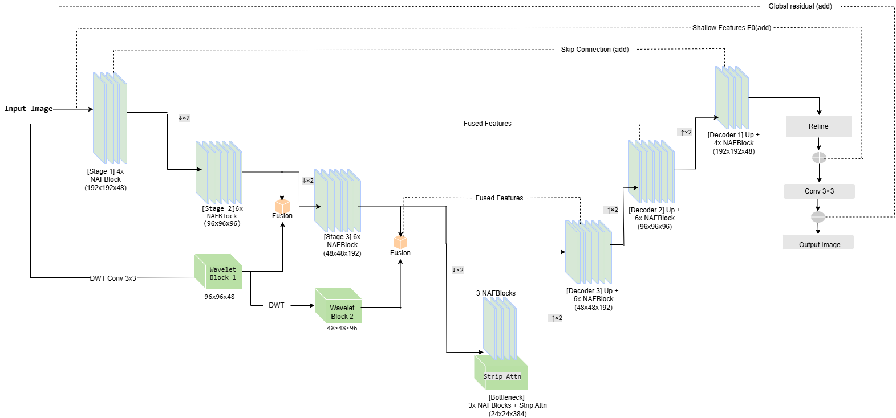
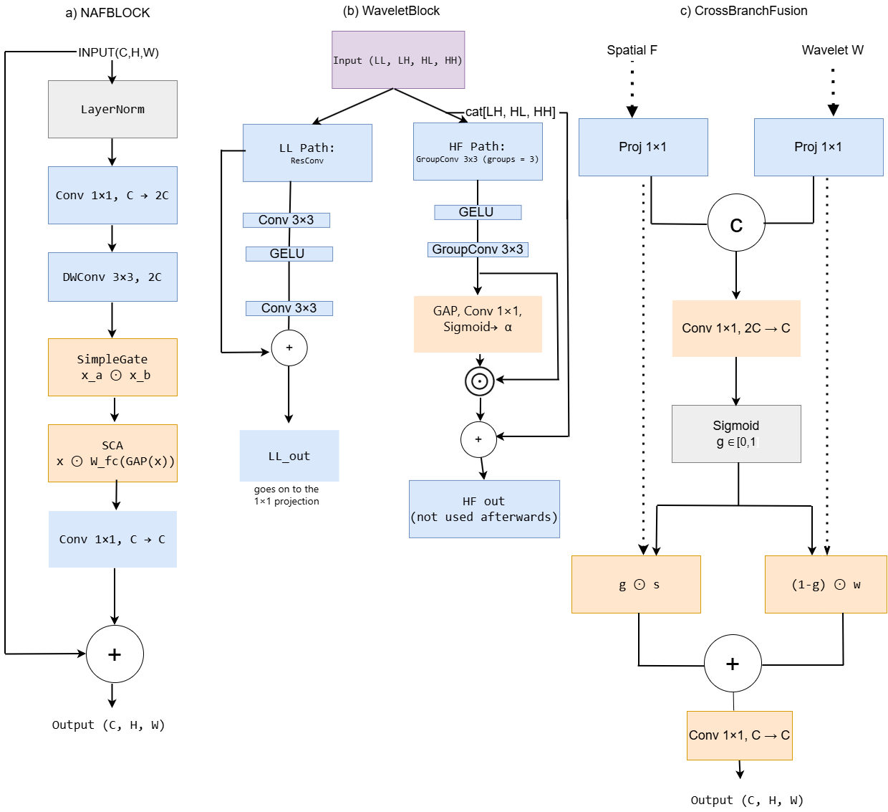

# WaveFusion-Net

Dual-branch spatial-wavelet fusion for blind image deblurring. This repository holds the code, trained weights and experiment records for the paper *Dual-Branch Spatial-Wavelet Fusion for Blind Image Deblurring* (IEEE NIGERCON 2026).


<p align="center">
  
</p>

The network runs a NAFNet-style spatial CNN and a Haar-wavelet branch side by side. A learned gate blends the two at every pixel and channel, at two encoder scales. The model has 9.48M parameters and needs 19.57 GMACs at 192x192. All experiments were trained on Kaggle's free tier (2x Tesla T4, 12-hour sessions).

## Quick start

```bash
git clone https://github.com/praann07/wavefusion-net-nigercon2026.git
cd wavefusion-net-nigercon2026
pip install -r requirements.txt
python scripts/infer.py --input blurry.png --output results/
```

The script downloads the matching checkpoint from the [v1.0 release](https://github.com/praann07/wavefusion-net-nigercon2026/releases/tag/v1.0) on first use (about 110 MB) and writes `<name>_deblurred.png`. Use `--dataset gopro`, `hide` or `realblurj` (default) to pick a checkpoint, or `--weights` for your own. Folders of images work too.

From Python:

```python
import torch
from wavefusion import WaveFusionNet

model = WaveFusionNet()
checkpoint = torch.load("wavefusion_realblurj_best.pth", map_location="cpu", weights_only=True)
model.load_state_dict(checkpoint["model_state_dict"])
model.eval()

with torch.no_grad():
    restored = model(blurry)   # blurry: (1, 3, H, W) in [0, 1]; padded to a multiple of 8 internally
```

## Results

Each model was trained on the training split of its own dataset and evaluated once on that dataset's test split, at full resolution (single run each).

| Dataset | Test images | PSNR (dB) | SSIM | Epochs |
|---|---:|---:|---:|---:|
| RealBlur-J | 980 | 29.57 | 0.8839 | 70 |
| GoPro | 1,111 | 28.83 | 0.8754 | 100 |
| HIDE | 1,329 | 28.93 | 0.8937 | 35 |

A second training seed on RealBlur-J gave 29.57 dB / 0.8841. On GoPro and HIDE the model trails the transformer baselines. The published baselines trained for 200 to 400 epochs on institutional clusters, while every run here fits inside one 12-hour session, and validation PSNR was still rising when training stopped. The paper (Table IV) lists the baseline scores, which are taken from the original publications. Those papers differ in training data, protocol and compute, so the comparison is indicative and not a controlled one.

Single test images, with the PSNR and SSIM of each image printed on it:

<p align="center"></p>
<p align="center"></p>
<p align="center"></p>

## Ablation study

All variants use the same seed, split, loss and epoch budget as the full model. A dash means the run was not performed.

| Variant | Params | GoPro PSNR / SSIM | RealBlur-J PSNR / SSIM |
|---|---:|---:|---:|
| Full model | 9.48M | 28.83 / 0.8754 | 29.57 / 0.8839 |
| Full model, training seed 7 | 9.48M | - | 29.57 / 0.8841 |
| Fixed fusion (no learned gate) | 9.39M | 28.79 / 0.8748 | 29.55 / 0.8841 |
| Spatial only (no wavelet branch) | 5.31M | 28.69 / 0.8730 | 29.53 / 0.8819 |
| No StripAttention | 9.18M | 28.75 / 0.8741 | 29.57 / 0.8836 |
| L1-only loss | 9.48M | 28.28 / 0.8652 | 29.18 / 0.8775 |

- The multi-term loss is the largest single contributor measured: L1-only costs 0.55 dB on GoPro and 0.39 dB on RealBlur-J. The four auxiliary terms were removed together, so this does not say which one matters.
- Removing the wavelet branch costs 0.14 dB on GoPro and 0.04 dB on RealBlur-J. Only about 0.46M of the 4.2M removed parameters affect the output (see the note below).
- The learned gate gives +0.04 dB on GoPro and +0.02 dB on RealBlur-J for 92,448 parameters. On RealBlur-J this is at the level of seed-to-seed noise.
- StripAttention is a small gain at most: 0.08 dB on GoPro and none on RealBlur-J.
- HIDE was not ablated: one run takes about 11 hours.

## How it works

| Part | Description |
|---|---|
| Spatial branch | U-shaped encoder-decoder of NAFBlocks (SimpleGate and Simplified Channel Attention, no activation functions), 48 to 384 channels, (4, 6, 6) blocks in the encoder, (6, 6, 4) in the decoder, 3 in the bottleneck |
| Wavelet branch | Fixed, non-trainable 2x2 Haar transform; WaveletBlocks refine the LL band at two scales and pass it to the fusion modules |
| CrossBranchFusion | At two encoder scales a sigmoid gate `g` blends the branches per channel and location: `g*s + (1-g)*w` |
| StripAttention | 1x7 and 7x1 depthwise strip attention in the bottleneck, aimed at directional blur |
| Loss | `1.0 L1 + 0.1 VGG19 + 0.05 FFT + 0.1 Sobel gradient + 0.02 wavelet high-frequency` |
| Output | Feature-level and image-level residuals, so the network learns a correction to the blurry input |

<p align="center"></p>

## Reproducing the experiments

Every experiment is a Kaggle notebook; step-by-step instructions, expected numbers and run times are in [`docs/REPRODUCE.md`](docs/REPRODUCE.md).

Protocol: each training set is split 90/10 with seed 42, the best validation checkpoint is selected (validation PSNR at epoch 1, every 10 epochs and the last epoch), and the test set is evaluated once at the end. Nothing from the test set enters any training decision. Training uses AdamW (learning rate 2e-4 with cosine decay to 1e-7, weight decay 1e-4), fp16 mixed precision, gradient clipping at 1.0, batch size 1 with 2 accumulation steps, 192x192 random crops with flips.

Each run writes the SHA256 of its sorted train, validation and test file lists (first 12 characters below). `python scripts/verify_splits.py` checks that all runs in this repository share them.

| Dataset (train / val / test) | Train | Validation | Test |
|---|---|---|---|
| GoPro (1,893 / 210 / 1,111) | `7d659adfcd1f` | `063ab299a04b` | `7018c8b387e9` |
| HIDE (5,727 / 636 / 1,329) | `e62b33858f1b` | `34a1110dae60` | `e216a016ecbd` |
| RealBlur-J (3,383 / 375 / 980) | `af1027140302` | `8431800b03e0` | `2a98ebbf6075` |

Run the unit tests with `pip install pytest` and then `pytest`.

## Repository layout

```
wavefusion/            the model (identical to the architecture trained in train/)
scripts/infer.py       deblur your own images with a released checkpoint
scripts/verify_splits.py   check the published split hashes
tests/                 smoke tests for the model
train/                 full-model notebooks: GoPro, HIDE, RealBlur-J (executed, with logs)
ablation/              fixed fusion, spatial only, and the interrupted-then-resumed RealBlur-J run
ablation/new_runs/     L1-only loss, no StripAttention, second-seed run
results/               split proofs, test evaluations, training histories and figures for every run
docs/                  REPRODUCE.md and the images used in this README
```

## Pretrained weights

The best-validation checkpoint of each full model is attached to the [v1.0 release](https://github.com/praann07/wavefusion-net-nigercon2026/releases/tag/v1.0).

| Checkpoint | Trained on | Epoch | Validation PSNR | Size |
|---|---|---:|---:|---:|
| [`wavefusion_realblurj_best.pth`](https://github.com/praann07/wavefusion-net-nigercon2026/releases/download/v1.0/wavefusion_realblurj_best.pth) | RealBlur-J | 70 | 30.08 dB | 114 MB |
| [`wavefusion_gopro_best.pth`](https://github.com/praann07/wavefusion-net-nigercon2026/releases/download/v1.0/wavefusion_gopro_best.pth) | GoPro | 100 | 29.70 dB | 114 MB |
| [`wavefusion_hide_best.pth`](https://github.com/praann07/wavefusion-net-nigercon2026/releases/download/v1.0/wavefusion_hide_best.pth) | HIDE | 35 | 26.45 dB | 114 MB |

`scripts/infer.py` downloads the one you need automatically. Each file is a dictionary with the keys `model_state_dict`, `optimizer_state_dict`, `split_proof`, `epoch`, `val_psnr` and `val_ssim`, and all three load into `wavefusion.WaveFusionNet` with `strict=True`.

## Notes

- The high-frequency path inside `WaveletBlock` and a third wavelet level are computed in the code, but their outputs are not used by the network, so they do not influence the result and receive no gradient. They hold 3.72M of the 9.48M parameters, which means 5.77M parameters affect the output. The checkpoints contain them, so the model class keeps them. The paper states this in its Limitations section.
- Results are single runs, apart from the two-seed check on RealBlur-J. Run-to-run variation is only measured there.
- The RealBlur-J fixed-fusion run was interrupted by a system sleep at epoch 50 and resumed from the epoch-50 weights with a fresh AdamW state. The two notebooks in `ablation/` are its two halves, and their split hashes are identical.
- Some ablations ran on a local RTX 5060 and the rest on Kaggle, so the notebooks contain outputs from both.

## Citation

```bibtex
@inproceedings{mamidala2026wavefusionnet,
  title     = {Dual-Branch Spatial-Wavelet Fusion for Blind Image Deblurring},
  author    = {Mamidala, Som Praneeth Babu and Reghunath, Lekshmi Chandrika and
               Imoize, Agbotiname Lucky and Tomazzoli, Claudio and Randieri, Cristian},
  booktitle = {IEEE NIGERCON},
  year      = {2026},
  note      = {to appear}
}
```

## License

The code is released under the [MIT License](LICENSE). The datasets keep their own licenses and are not redistributed here: GoPro (Nah et al., CVPR 2017), HIDE (Shen et al., ICCV 2019) and RealBlur (Rim et al., ECCV 2020). Baseline scores in the paper are taken from the original publications.
